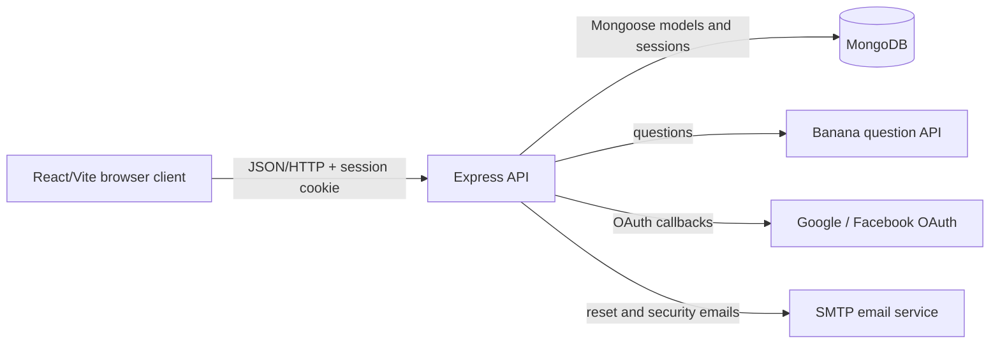

# Architecture

## Architecture diagram



### Summary

Banana Quiz uses a distributed client-server architecture in which the
React/Vite browser client owns presentation, navigation, and interaction while
the Express API owns authentication, game rules, validation, and integration
with MongoDB and external services; the browser and API communicate through
JSON over HTTP with a server-side session cookie.

## Client layer

The React application defines routes and pages for landing, authentication,
dashboard, game play, achievements, leaderboard, history, and profile
management. Shared components provide buttons, cards, audio controls, and
authentication guards. `AuthProvider` restores the session on startup and
shares the current user and statistics with protected pages.

## Server layer

`server/src/app.js` configures Helmet, CORS, compression, JSON parsing,
logging, rate limiting, sessions, Passport, route mounting, and error
handling. Route modules validate input and delegate business rules to
services. Services keep game scoring, achievements, login history, mail, and
external question retrieval out of the route layer.

## Persistence

Mongoose models represent users, game sessions, completed games, scores,
password reset tokens, and login events. MongoDB stores both application data
and server-side sessions. User-specific routes always use the authenticated
user ID when reading or changing private data.

## Main request path

For a game answer, the client calls `POST /api/game/answer`. The protected
route validates the session ID and numeric answer, the game service evaluates
the result and updates persistence, and the response returns the result and
updated statistics. The client then renders feedback and advances the game.

## Final folder tree

Generated build output and dependency folders are omitted from this tree:
`client/node_modules/`, `server/node_modules/`, and `client/dist/`.

```text
Banana-Quiz-Game/
├── ASSIGNMENT_BRIEF.md
├── README.md
├── client/
│   ├── index.html
│   ├── package.json
│   ├── package-lock.json
│   ├── vite.config.js
│   ├── public/
│   │   ├── favicon.svg
│   │   └── icons.svg
│   └── src/
│       ├── api/
│       │   └── client.js
│       ├── assets/
│       ├── audio/
│       ├── components/
│       ├── context/
│       ├── hooks/
│       ├── lib/
│       ├── pages/
│       ├── App.css
│       ├── App.jsx
│       ├── index.css
│       └── main.jsx
├── docs/
│   ├── architecture.md
│   ├── events.md
│   ├── interoperability.md
│   ├── references.md
│   ├── testing.md
│   ├── version-control.md
│   └── virtual-identity.md
└── server/
    ├── .env.example
    ├── package.json
    ├── package-lock.json
    ├── server.js
    └── src/
        ├── config/
        ├── middleware/
        ├── models/
        ├── routes/
        ├── services/
        └── utils/
```
